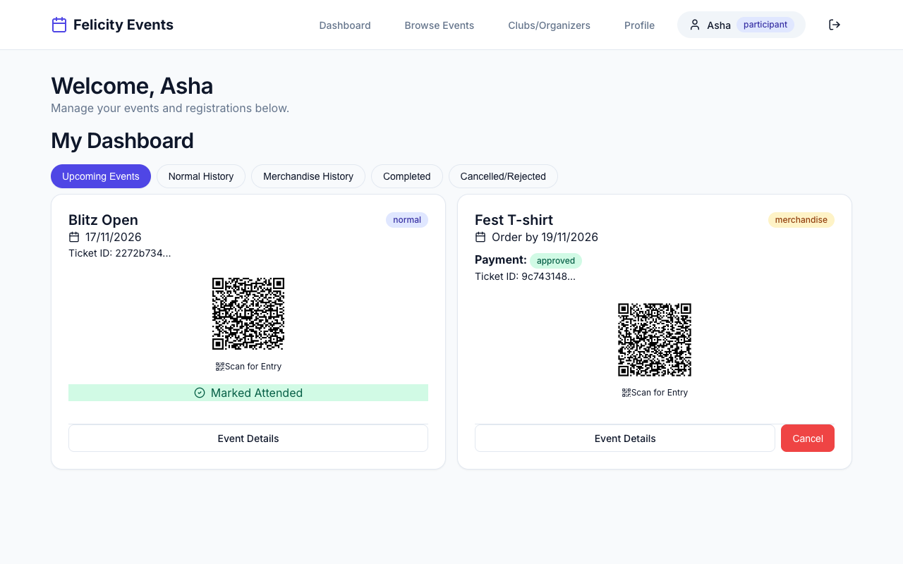
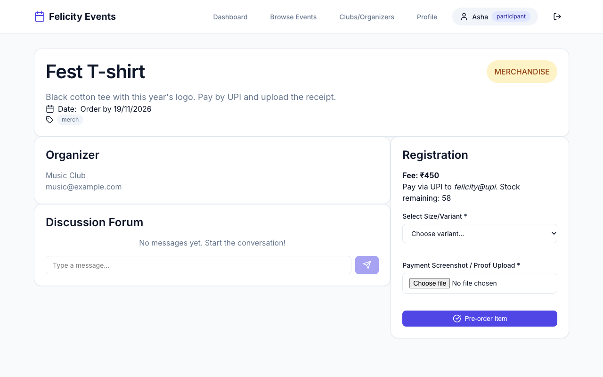
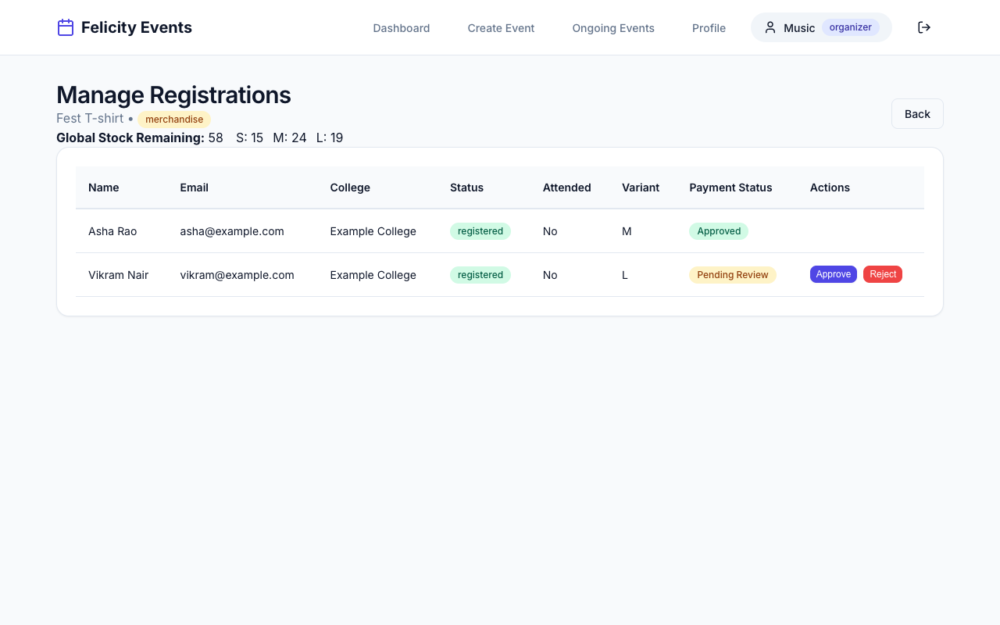
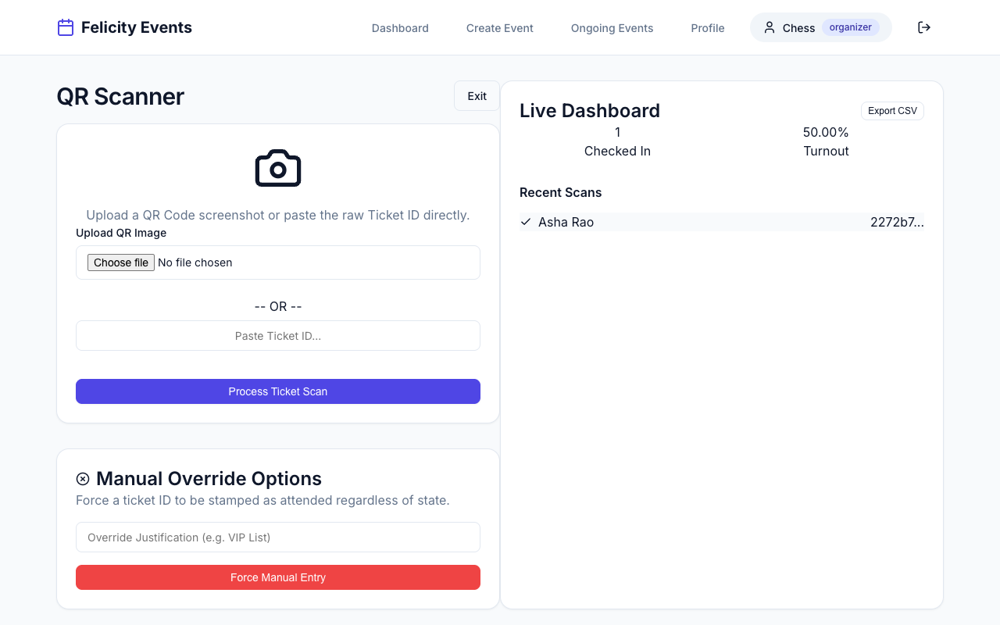

# felicity-events

An event and merchandise platform for a college fest, built with Express, MongoDB and React:
- Clubs publish events and sell merchandise.
- Participants register and receive QR tickets.
- Organizers approve payments and scan tickets at the gate.

It started as assignment 1 of Design and Analysis of Software Systems (IIIT Hyderabad, spring 2026). After the course I load-tested the booking paths and found that concurrent requests could oversell everything the app sells. Those paths now use atomic updates, and 16 API tests cover them.



## What was broken, and the fix

The original code followed the usual pattern: read the event, check the count in JavaScript, then write. Requests that arrive together all pass the check before any of them writes. The tests fire concurrent requests at an in-memory MongoDB through the real HTTP API (`backend/test/concurrency.test.js`):

| scenario | before | after |
|---|---|---|
| 100 buyers, 20 t-shirts | 100 orders accepted, stock shows 19 | 20 orders, stock 0 |
| 40 buyers, 5 size-S shirts | 40 orders, S stock shows 4 | 5 orders, S stock 0 |
| one user clicks "register" 20 times at once | 16 registrations | 1 |
| one buyer sends 10 orders, limit 2 | 9 orders kept | 2 |
| one order cancelled 5 times at once | all 5 accepted; stock ends at 4 after starting at 3 | 1 accepted, stock 3 |
| one ticket scanned at 10 gates at once | admitted 9 times | admitted once |
| 100 different tickets scanned at once | attendance count 1 | 100 |
| 200 people, 50 seats | 50 or 51 seats taken (varies by run) | 50 |

The fixes:
- **Seats and stock** are taken by one conditional update. MongoDB applies the check and the decrement together, so they cannot interleave:

      updateOne({ _id, stockQuantity: { $gt: 0 } }, { $inc: { stockQuantity: -1 } })

  Seats work the same way, through a `registeredCount` field compared with `registrationLimit` using `$expr`.
- **One seat per person** is enforced by a unique partial index on `(user, event)` over active registrations of normal events.
- **Purchase limits** are counted after inserting. If the count is over the limit, the new order removes itself.
- **Cancel, approve, reject and scan** each change state with one `findOneAndUpdate` that matches the old state. A repeated click finds nothing to change.

The same tests found four plain bugs, also fixed:
- the order for the last item in stock could never be approved;
- a cancelled ticket's QR code still got in at the gate;
- a manual re-entry counted the person twice;
- merchandise pages showed "Invalid Date".

[docs/concurrency.md](docs/concurrency.md) explains each race and why the fix is enough.

## Features

**Participants**
- Sign up and browse events.
- Register, with custom form fields set by the organizer.
- Order merchandise by size, uploading a payment receipt.
- Get QR tickets and cancel registrations.
- Post in each event's discussion forum, which refreshes every 10 s.
- Leave anonymous feedback after an event.

**Organizers**
- Create and edit events.
- Approve or reject payments.
- Scan QR codes from an uploaded image or a pasted ticket id.
- Override at the gate, with an audit log.
- Watch live attendance and export it to CSV.
- Pin and moderate forum posts.
- Post a Discord webhook announcement when an event is published.

**Admin**
- Create, disable and enable organizer accounts.
- See site-wide analytics.
- Approve organizer password resets: a new password is generated and stored hashed.

Authentication uses JWT, with roles checked on every route. Passwords are hashed with bcrypt.

| browse | order merchandise |
|---|---|
|  |  |
| **approve payments** | **scan tickets** |
|  |  |

## Run it

The quickest way needs no database. The demo starts a throwaway in-memory MongoDB with three clubs, four events and demo accounts:

```bash
cd backend && npm ci && npm run demo          # api on :3000
cd frontend && npm ci && npm run dev          # ui on :5173
```

Log in as `asha@example.com` (participant), `music@example.com` (organizer) or `admin@example.com`. Every demo account uses the password `demo1234`.

With a real database, copy `backend/.env.example` to `backend/.env`, set `MONGODB_URI` and `JWT_SECRET`, then run `npm start`. `npm run seed` loads the same demo data into an empty database.

A database created by the original version needs `npm run backfill` once. It fills in the new seat counts and builds the unique index. If some user already holds two seats in one event, it reports them instead of failing.

```bash
cd backend && npm test      # 16 api tests against an in-memory mongod
cd frontend && npm run lint && npm run build
```

## Layout

```
backend/src/app.js          express app and routes (no db, no listen)
backend/src/server.js       env checks, db connection, admin seed, listen
backend/src/controllers/    events, auth, admin, forum, feedback, password resets
backend/src/models/         mongoose schemas
backend/scripts/            demo, seed, backfill
backend/test/               concurrency, workflow and backfill tests
frontend/src/pages/         react pages per role
```

## Limits

- Payment receipts are stored as base64 strings in MongoDB, and Express's default 100 kB body limit applies. Large photos are rejected; real storage would use object storage and signed URLs.
- Confirmation emails are logged, not sent.
- The forum and the attendance dashboard poll every 10 s instead of using websockets.
- The purchase-limit check can reject both of two simultaneous orders from one user when only one was over the limit. It never lets the limit be exceeded.
